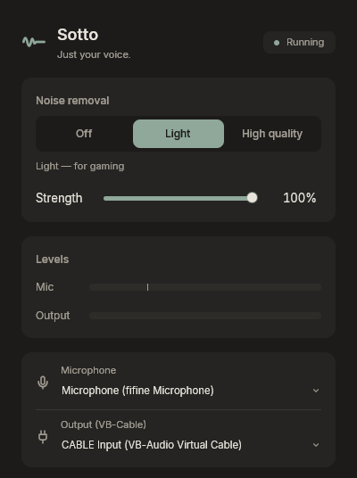
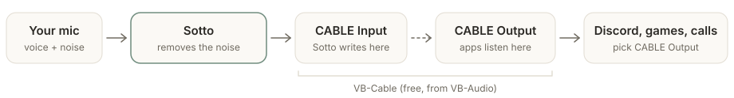

<div align="center">


# Sotto

**Just your voice.**

Sotto removes keyboard clicks, fans and room noise from your microphone in real time,
so Discord, games and calls hear only you. Small, CPU-only, quiet while you play.

**[Download for Windows](https://github.com/hamadsh2/Sotto/releases/latest)** &nbsp;·&nbsp; [Setup](#setup) &nbsp;·&nbsp; [Privacy](#your-audio-stays-yours)

<br>



</div>

<br>

## How it works

<picture>
  <source media="(prefers-color-scheme: dark)" srcset="assets/readme/how-it-works-dark.svg">
  
</picture>

- **Two engines:** *Light* (RNNoise) for gaming, *High quality* (DeepFilterNet) for
  recording and calls, or *Off* to compare. A strength slider mixes your original voice back in.
- **Voice chain**, each part optional: low-cut filter, voice EQ, noise gate, auto gain and a limiter.
- **Mute from anywhere** with a shortcut (default **Ctrl+Shift+F9**, works in games), the window or the tray.
- **Stays out of the way:** closing the window keeps it running in the tray, and it can start with Windows.

## Setup

Windows 10 or 11 (64-bit).

1. **Install [VB-Cable](https://vb-audio.com/Cable/)**, a free virtual audio cable:
   download the **"New Package"** zip (`VBCABLE_Driver_Pack46` or newer, not the old
   one), extract all the files, right-click `VBCABLE_Setup_x64.exe` → **Run as
   administrator** → **Install Driver**, then restart Windows.
2. **Install Sotto** from [Releases](https://github.com/hamadsh2/Sotto/releases/latest):
   run `Sotto-<version>-setup.exe`. No admin rights needed.
3. **In Sotto,** pick your microphone and **CABLE Input**.
4. **In Discord, your game or call app,** set the microphone to **CABLE Output**.
   Your headphones stay as they are.

<details>
<summary><b>Windows says “Windows protected your PC”?</b></summary>
<br>

The installer isn't code-signed yet, so SmartScreen may warn the first time. Choose
**More info → Run anyway**, after [checking the file's SHA-256](#official-builds) if you like.

</details>

<details>
<summary><b>Uninstalling</b></summary>
<br>

Use *Settings → Apps*. Your settings stay in `%APPDATA%\Sotto` in case you come back;
delete that folder to remove them too.

</details>

## Your audio stays yours

Sotto streams on exactly **two** devices: the microphone you choose and VB-Cable's **CABLE Input**.

- It **never streams live to your headphones, speakers or DAC**, so your voice is never doubled
  in a screen share or recording. The one exception is **Hear yourself**: when you click Play,
  it plays a 5-second clip of your cleaned voice you just recorded, once, on your default
  playback device, then closes it. The clip stays in memory and is never sent to a virtual
  cable, Voicemeeter or Sotto's own output.
- It **never changes Windows sound settings**: not your default devices, volume, formats or enhancements.
- Your **mic is opened in shared mode**, so other apps can still use it.
- **Hide my voice from screen shares** (on by default): Sotto plays into CABLE Input in
  WASAPI *exclusive* mode. A whole-screen share in Discord records every app's sound,
  which used to include your voice on its way to the cable, so viewers heard you twice.
  Exclusive mode skips the Windows mixer the share listens to, so they hear you once.
  While it's on, no other app can play into CABLE Input. If another app already holds
  the cable exclusively, Sotto waits for it.
- It creates no virtual devices, and never switches to another device: if one you chose is unplugged, it waits.
- **No telemetry.** The only network use is the update check against this repository's releases.

If CABLE Input ever becomes your default playback device, Sotto tells you how to fix it,
and leaves the change to you.

## Light on your PC

Measured on an Intel Core i5-14400F, Windows 11, with the window in the tray:

| | Light | High quality |
|---|:---:|:---:|
| CPU (whole machine) | ~0.1 % | ~0.8–0.9 % |
| Time per 10 ms of audio (median / p99) | 0.08 / 0.31 ms | 1.2 / 1.9 ms |
| Memory (whole app) | ~15 MB | ~28 MB |
| GPU | 0 % | 0 % |

The window shows Sotto's own live CPU, latency and memory at the bottom.

## Official builds

Official builds are published **only** on this repository's
[Releases](https://github.com/hamadsh2/Sotto/releases) page, built from the tagged
source by [GitHub Actions](.github/workflows/release.yml).

<details>
<summary><b>Verifying a download</b></summary>
<br>

Each release lists the SHA-256 of every file and includes `SHA256SUMS.txt`. In PowerShell:

```powershell
Get-FileHash .\Sotto-0.2.0-setup.exe -Algorithm SHA256
```

The hash must match the one on the release page.

</details>

<details>
<summary><b>How updates work</b></summary>
<br>

Sotto checks this repository's releases at start and once a day (you can turn that off)
and tells you when there's a new version. It installs only when you click **Install**,
and only after verifying the download's ed25519 signature against the public key built
into the app.

</details>

<details>
<summary><b>Building from source</b></summary>
<br>

Requires Rust (MSVC toolchain) on Windows.

```powershell
cargo build --release      # target\release\sotto.exe (the app) and sotto-cli.exe
cargo test --release
```

`sotto-cli` runs the same audio engine without a window, for testing and measurements
(`sotto-cli --help`).

</details>

## License

Sotto is free software under the [GNU General Public License v3.0 only](LICENSE).

It builds on [RNNoise](https://github.com/xiph/rnnoise) (via
[nnnoiseless](https://github.com/jneem/nnnoiseless)),
[DeepFilterNet](https://github.com/Rikorose/DeepFilterNet),
[cpal](https://github.com/RustAudio/cpal), [GPUI](https://www.gpui.rs/),
the [Inter](https://rsms.me/inter/) font and [Lucide](https://lucide.dev) icons.
All third-party licenses are in the app (*About Sotto*) and in
[`assets/THIRD_PARTY_LICENSES.txt`](assets/THIRD_PARTY_LICENSES.txt).
VB-Cable is made by VB-Audio and is not part of Sotto.
